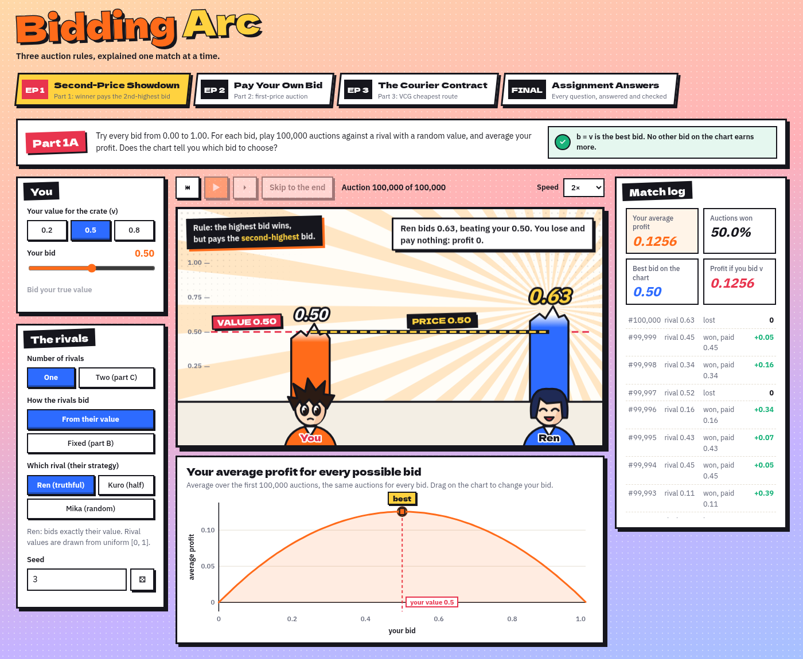
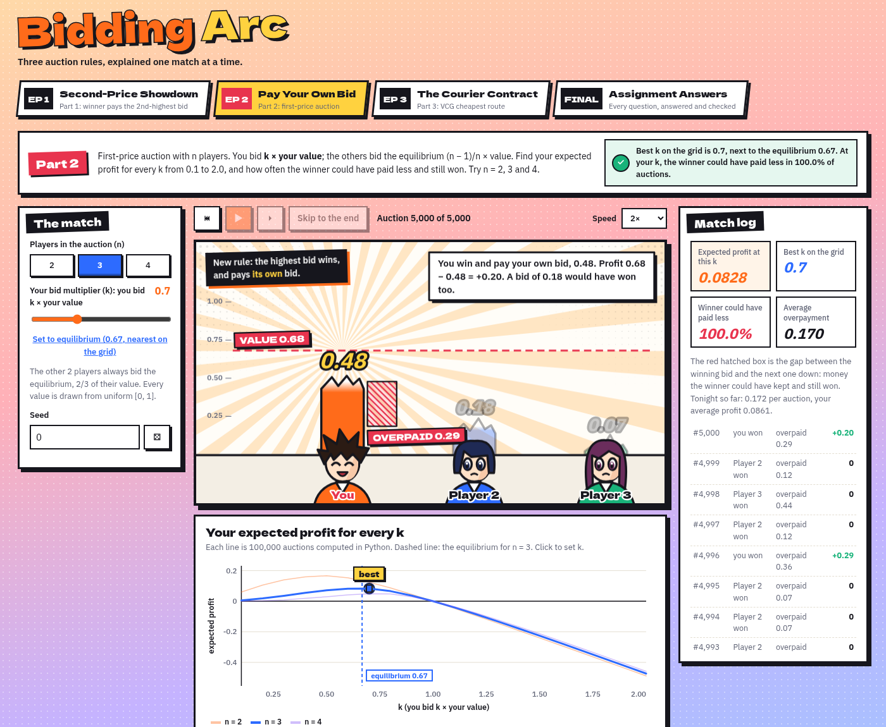
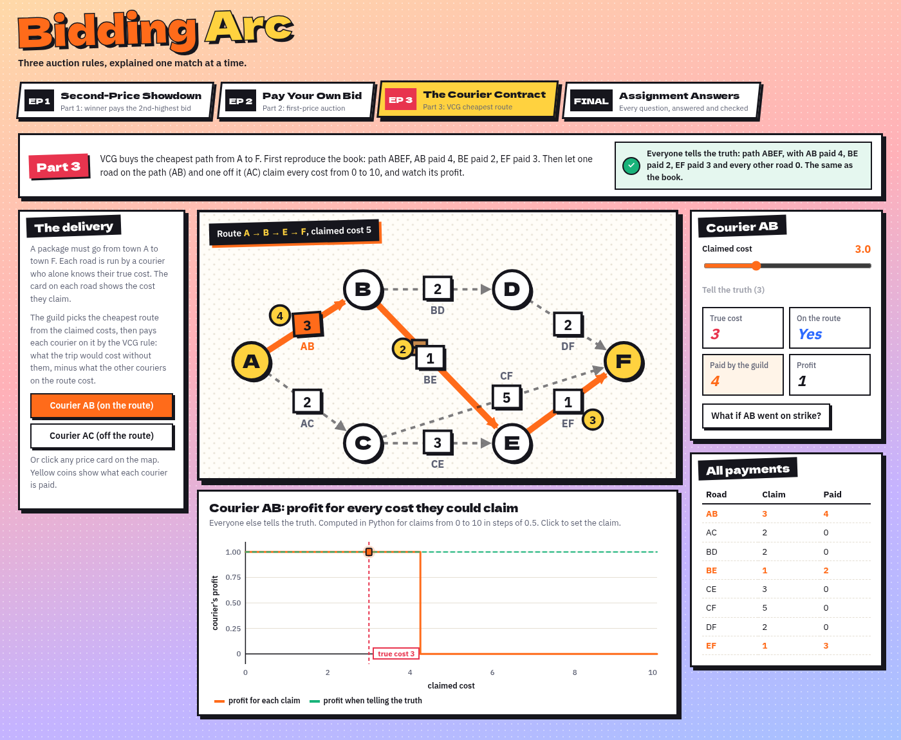
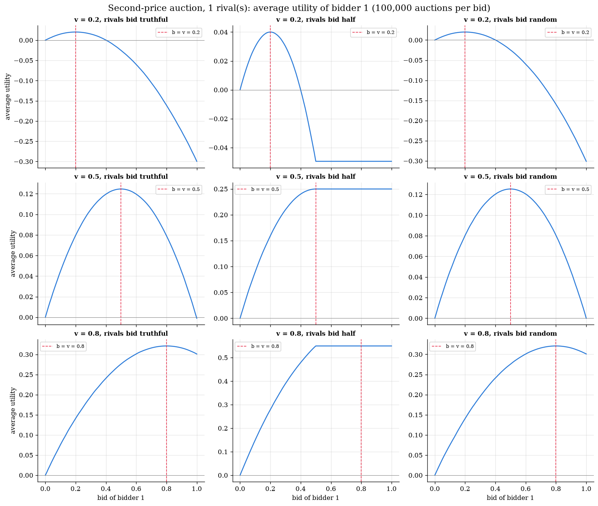
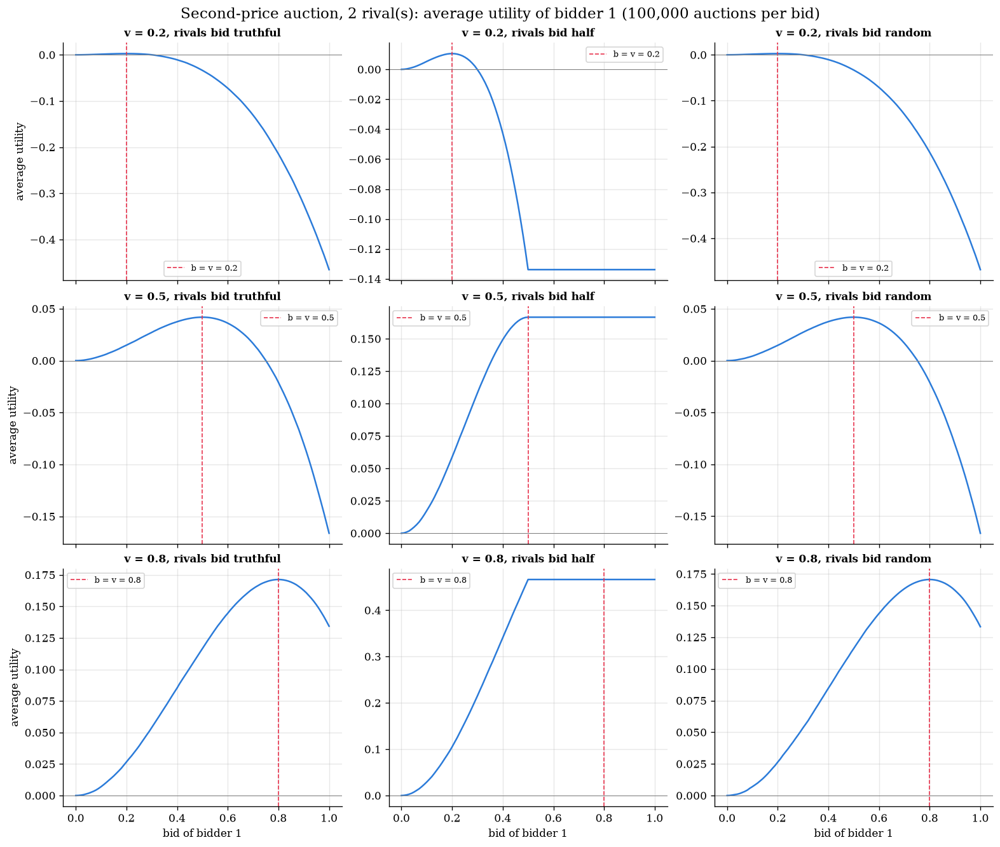
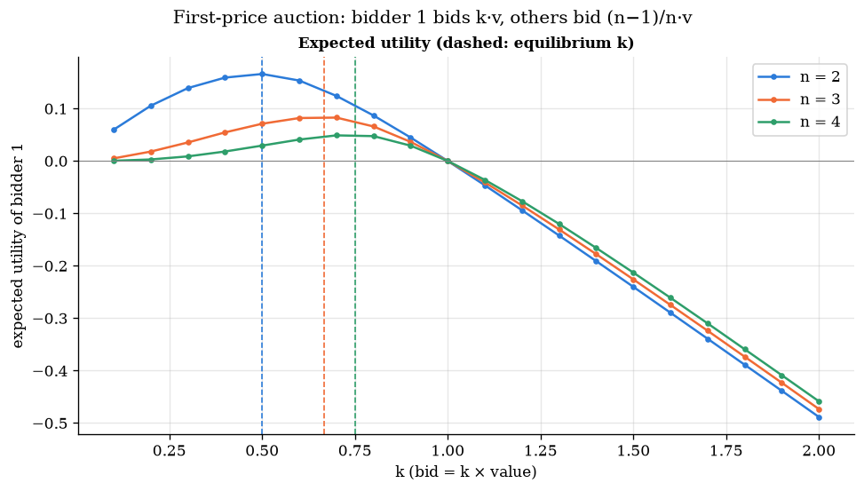
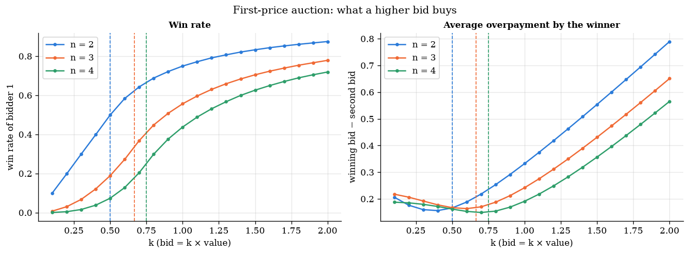
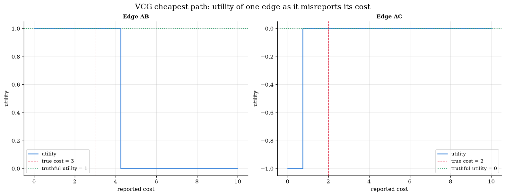

# Assignment 4: Auctions and VCG

Autonomous Systems, Assignment 4 (Instructor: Dr. Gaurav Harit).

When is telling the truth the best strategy? We simulate three payment rules in Python and check:

| Rule | Best strategy | Why |
| --- | --- | --- |
| Second-price auction | Bid your true value | You pay the next-highest bid, so your bid only decides *whether* you win. |
| First-price auction | Bid $\frac{n-1}{n} \times$ value | You pay your own bid, so a truthful bid earns zero profit. |
| VCG (cheapest path) | Report your true cost | Your payment does not depend on what you report. |

The full write-up is in [report/main.pdf](report/main.pdf).

## Run it

**Python (all plots and numbers):**

```bash
uv run auto
```

This saves every plot (PNG and PDF) and `results.json` to `output/`.

**Interactive simulator (the same Python, run in the browser with Pyodide):**

```bash
cd web
npm install
npm run dev
```

## Simulator

**Part 1: second-price auction.** Play 100,000 auctions and watch the average profit for every bid. The curve peaks at your true value.



**Part 2: first-price auction.** The hatched box shows how much the winner overpaid. The best bid fraction is close to the equilibrium $(n-1)/n$.



**Part 3: VCG for the cheapest path A→F.** Change any road's claimed cost and see its payment and profit. No false claim beats the truth.



## Results

**Part 1: second price, one rival.** Average profit for each bid. In all nine panels the best bid is $b = v$ (red line).



**Part 1: second price, two rivals.** Profits are lower, but the best bid is still $b = v$.



**Part 2: first price.** Average profit for each bid fraction $k$. Each curve peaks near the equilibrium $(n-1)/n$ (dashed), and a truthful bid ($k = 1$) earns 0.



**Part 2: win rate and overpayment.** Bidding higher wins more often but makes the winner overpay by more.



**Part 3: VCG.** Profit of road AB (on the path) and road AC (off it) for every claimed cost. No claim beats the truth.



## Layout

```text
src/auto/       Python code: second_price.py, first_price.py, vcg.py, plots.py
web/            React + Pyodide simulator (copies src/auto into the browser)
report/         LaTeX report (only main.pdf is tracked)
docs/           Screenshots for this README
```

## Team

| Name | Roll no. |
| --- | --- |
| Naman Soni | B23CS1094 |
| Vishal Kishore | B23CS1078 |
| Sandeep Soni | B23CM1035 |
| Aaditya Jain | B23CS1091 |
